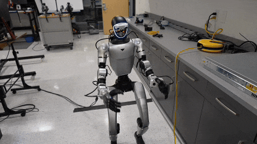
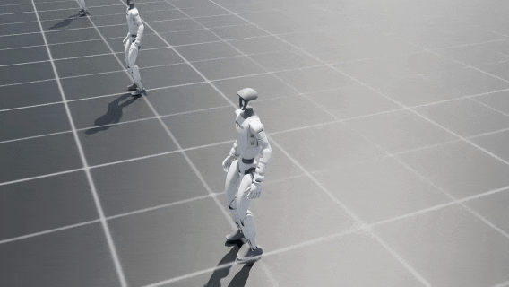
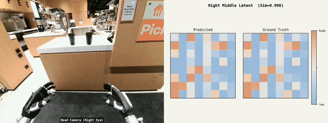
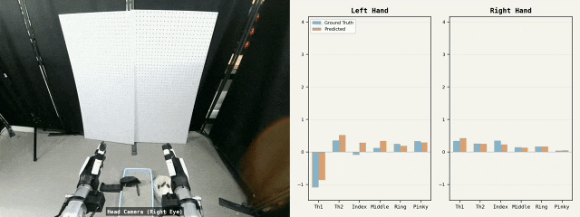

<h1 align="center">
  Learning Versatile Humanoid Manipulation with Touch Dreaming
</h1>
<p align="center">
  <a href="https://yaruniu.com/" target="_blank">Yaru Niu</a><sup>1</sup>&nbsp;&nbsp;&nbsp;
  Zhenlong Fang<sup>1</sup>&nbsp;&nbsp;&nbsp;
  <a href="https://wudicbh.github.io/" target="_blank">Binghong Chen</a><sup>1</sup>&nbsp;&nbsp;&nbsp;
  <a href="https://www.shuai-zhou.com/" target="_blank">Shuai Zhou</a><sup>1</sup>&nbsp;&nbsp;&nbsp;
  <a href="https://revanthsenthil.github.io/" target="_blank">Revanth Senthilkumaran</a><sup>1</sup>&nbsp;&nbsp;&nbsp;
  <br />
  <a href="https://haozhang-thu.github.io/" target="_blank">Hao Zhang</a><sup>1,2</sup>&nbsp;&nbsp;&nbsp;
  Bingqing Chen<sup>3</sup>&nbsp;&nbsp;&nbsp;
  Chen Qiu<sup>3</sup>&nbsp;&nbsp;&nbsp;
  <a href="https://etaic.github.io/" target="_blank">H. Eric Tseng</a><sup>2</sup>&nbsp;&nbsp;&nbsp;
  <a href="https://jonfranc.com/" target="_blank">Jonathan Francis</a><sup>1,3</sup>&nbsp;&nbsp;&nbsp;
  <a href="https://www.meche.engineering.cmu.edu/directory/bios/zhao-ding.html" target="_blank">Ding Zhao</a><sup>1</sup>&nbsp;&nbsp;&nbsp;
  <br />
  <sup>1</sup>Carnegie Mellon University&nbsp;&nbsp;&nbsp;
  <sup>2</sup>UT Arlington&nbsp;&nbsp;&nbsp;
  <sup>3</sup>Bosch Center for AI&nbsp;&nbsp;&nbsp;
  <br />
</p>

<p align="center">
    International Conference on Intelligent Robots and Systems (IROS) 2026<br />
    <a href="https://humanoid-touch-dream.github.io/">Website</a> |
    <a href="https://arxiv.org/pdf/2604.13015">Paper</a> |
    <a href="https://humanoid-touch-dream.github.io/wbc_mujoco/dist/index.html">Interactive WBC Demo</a>
</p>

<p align="center">
  
  <br />
  <sub>Autonomous policy (HTD) for long-horizon loco-manipulation</sub>
</p>

## System overview

HTD combines a manipulation policy with a whole-body controller (WBC). The
manipulation policy predicts arm, hand, torso, and optional locomotion commands
from visual, tactile, and robot-state observations. The robot controller
executes these commands using arm inverse kinematics, hand control, and a WBC
policy that tracks torso pose and locomotion commands through the lower body
and waist.

Vision Pro teleoperation and learned-policy rollout use the same robot
controller. The modules below cover collection, training, and deployment.

| Module | What it provides |
| --- | --- |
| [HTD WBC](https://github.com/chrisyrniu/IsaacLab-Decoupled-WBC) | Isaac Lab teacher training, student distillation, simulation evaluation, and standalone G1 deployment |
| [Robot control](robot_control/README.md) | Shared hardware runtime combining WBC, arm inverse kinematics, Inspire hand drivers, and retargeting |
| [Data collection](data_collect/README.md) | Vision Pro teleoperation, camera/tactile recording, HDF5 preprocessing, and validation |
| [Policy training](htd_policy/README.md) | HTD, MXT, and ACT training |
| [Policy rollout](policy_rollout/README.md) | Live HTD, MXT, and ACT (HIT) inference with camera and tactile feedback |

## Getting started

Clone the repository:

```bash
git clone https://github.com/chrisyrniu/humanoid-touch-dream.git
cd humanoid-touch-dream
```

For robot use, start with the controller setup below, then collect demonstrations
or run a trained policy. With an existing dataset, go directly to
[policy training](htd_policy/README.md). Each module guide includes its environment
and installation commands; keep robot control, collection, and policy training
in separate environments. Rollout reuses the policy environment.

### Whole-body control

For data collection and policy rollout, follow the
[robot-control setup](robot_control/README.md). The WBC checkpoint, matching
[deployment YAML](robot_control/g1_wbc_policy/g1_student_htd.yaml), robot descriptions,
meshes, and hand-retargeting assets are included under `robot_control/`. These
workflows do not require the WBC submodule. Run the controller and hand driver
alongside either the collector or policy rollout.

<p align="center">
  
  <br />
  <sub>HTD whole-body controller tracking locomotion and torso-pose commands</sub>
</p>

<p align="center">
  <a href="https://humanoid-touch-dream.github.io/wbc_mujoco/dist/index.html">
    
  </a>
</p>

To train or evaluate the WBC itself, initialize the submodule from the repository
root, then use `htd_wbc/isaaclab_decoupled_wbc/` in its own environment:

```bash
git submodule update --init --recursive
```

Its [training guide](https://github.com/chrisyrniu/IsaacLab-Decoupled-WBC/blob/main/docs/training.md)
covers teacher training, student distillation, and simulation evaluation on a
single GPU. Example teacher and student checkpoints are included, with a
[deployment guide](https://github.com/chrisyrniu/IsaacLab-Decoupled-WBC/blob/main/docs/deployment.md) for running
the controller on G1 independently. The WBC checkpoint and the manipulation
policy checkpoint are separate; each must match its configuration.

### Collect demonstrations

With the robot controller running, follow the
[collection guide](data_collect/README.md) for Vision Pro connection, recording,
and preprocessing into the HDF5 fields used by policy training. The standard
hardware setup uses Inspire DFTP hands; F1 hands have a separate sensor profile.

### Train a manipulation policy

For an existing processed HDF5 dataset, install the
[policy environment](htd_policy/README.md#installation).
After installation, return to the repository root, then run:

```bash
conda activate htd_policy
cd htd_policy
python train_mxt.py --touch_dreaming \
  --dataset_dir /path/to/processed/my_task \
  --ckpt_dir ../runs/run --task_name my_task --min_val_num 1
```

Use your own processed demonstrations with at least two episodes. This example
uses DFTP hands with head and wrist cameras; see the
[training guide](htd_policy/README.md) for other camera/hand configurations.
Outputs go to `runs/run_my_task_HTD/` in the repository. Add `--wandb` to log to
the W&B project `htd`, or choose a project with `--wandb_name YOUR_PROJECT`.

### Deploy a manipulation policy

Follow the [rollout guide](policy_rollout/README.md) to deploy the training output
at `runs/run_my_task_HTD/`, or another HTD, MXT, or ACT (HIT) run. Keep its saved
configuration and normalization statistics with the checkpoint, and use the same
hand type and camera layout as training. Start the hand driver and robot
controller before launching rollout.

Touch dreaming is an auxiliary training objective; normal policy inference does
not require touch prediction. The examples below visualize dreaming outputs,
which you can optionally record during rollout with `--dream_touch True`.

<p align="center">
  
  <br />
  <sub>Tea: tactile latent dreaming</sub>
  <br /><br />
  
  <br />
  <sub>Scoop: force dreaming</sub>
</p>

## Citation

If you find this work useful, please consider citing our paper:

```bibtex
@inproceedings{niu2026humanoidtouchdream,
  title={Learning Versatile Humanoid Manipulation with Touch Dreaming},
  author={Niu, Yaru and Fang, Zhenlong and Chen, Binghong and Zhou, Shuai and Senthilkumaran, Revanth Krishna and Zhang, Hao and Chen, Bingqing and Qiu, Chen and Tseng, H. Eric and Francis, Jonathan and Zhao, Ding},
  booktitle={IEEE/RSJ International Conference on Intelligent Robots and Systems (IROS)},
  year={2026}
}
```

## Acknowledgements

- The HTD whole-body controller builds on [LeggedLab](https://github.com/Hellod035/LeggedLab).
- The HTD manipulation policy builds on MXT from [Human2LocoMan](https://github.com/chrisyrniu/Human2LocoMan).
- Our policy baselines are adapted from [Human2LocoMan](https://github.com/chrisyrniu/Human2LocoMan), [HumanPlus](https://github.com/MarkFzp/humanplus), and [ACT](https://github.com/tonyzhaozh/act).
- Our teleoperation pipeline uses Apple Vision Pro data streaming from [OpenTeleVision](https://github.com/OpenTeleVision/TeleVision) and [VisionProTeleop](https://github.com/Improbable-AI/VisionProTeleop). We also benefited from [Unitree XR Teleoperate](https://github.com/unitreerobotics/xr_teleoperate) during early development.
- Our dexterous hand retargeting is adapted from [Dex Retargeting](https://github.com/dexsuite/dex-retargeting).
