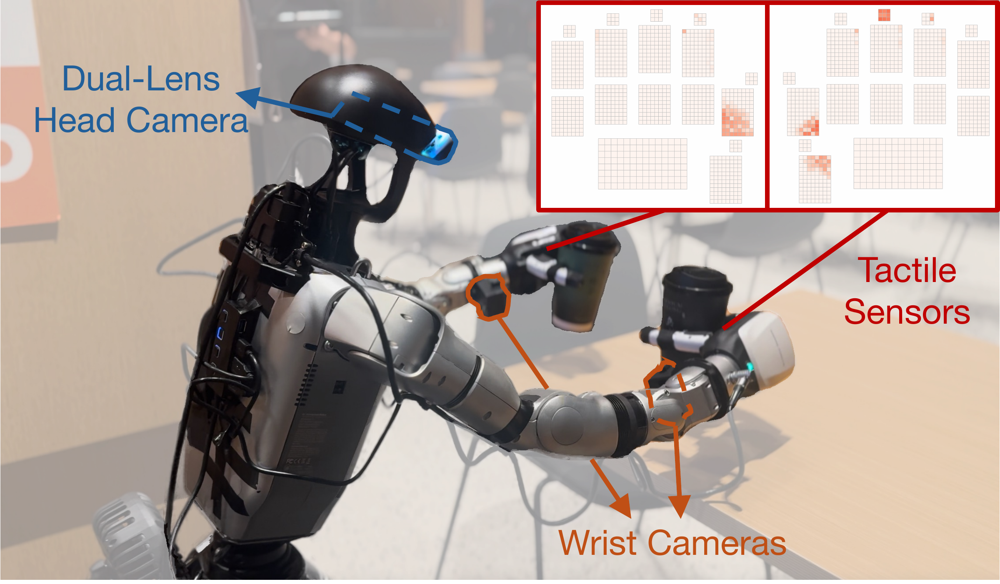

# Data collection and dataset preparation

Collect G1 demonstrations with Apple Vision Pro, a stereo head camera, optional
wrist cameras, and Inspire DFTP or F1 hands. The collector sends targets to the
separate [robot controller](../robot_control/README.md).



## Requirements and installation

Complete the [controller installation](../robot_control/README.md) first,
including native Cyclone DDS and the Unitree/Inspire SDK checkouts. Keep the
robot assets in place. Use a separate collection environment and this checkout.

On Ubuntu, install camera utilities, the overlay font, and OpenCV libraries:

```bash
sudo apt install v4l-utils fonts-freefont-ttf libgl1 libglib2.0-0
```

From the repository root:

```bash
export HTD_ROOT="$(pwd)"
export HTD_DEPS="$(dirname "$HTD_ROOT")/htd-deps"
conda create -n htd_data python=3.10 pip
conda activate htd_data
python -m pip install -e "$HTD_ROOT/data_collect"
```

If the SDK checkouts are elsewhere, set `HTD_DEPS` to their parent directory.
Install the selected hand SDK in this environment too. For **DFTP**:

```bash
python -m pip install -e "$HTD_DEPS/unitree_sdk2_python" \
  -e "$HTD_DEPS/inspire_hands_unitree_sdk/dftp/inspire_hand_sdk"
```

For **F1**, use this instead; do not mix the two hand SDKs in one environment:

```bash
python -m pip install "pymodbus>=3.10,<4" -e "$HTD_DEPS/inspire_hands_unitree_sdk/f1"
```

## Headset and cameras

The headset and host must reach each other. Choose a connection:

- **Pass-through:** install and start Tracking Streamer using
  [VisionProTeleop](https://github.com/Improbable-AI/VisionProTeleop), then use the
  headset IP below.
- **Vuer VR:** follow [OpenTeleVision](https://github.com/OpenTeleVision/TeleVision)
  for certificate setup. Save the host certificate and private key as
  `data_collect/cert.pem` and `data_collect/key.pem`, trust the issuing certificate
  on the headset, and open `https://HOST:8012?ws=wss://HOST:8012` after starting
  collection.

USB camera discovery matches `3D USB Camera` for the
[head camera](https://www.amazon.com/dp/B0CBLZJZBT) and `Global Shutter Camera` for
the [wrist cameras](https://www.amazon.com/dp/B0C3C2YVK9) in `htd_data_collect.py`. Adapt these
names for different cameras. Check the views from the repository root:

```bash
python data_collect/check_camera.py --list
python data_collect/check_camera.py \
  --device 0 --width 1280 --height 480 --fps 30
```

The preview requires a graphical desktop; press `q` or Ctrl+C to close it.
The collector rotates stereo head images by 180° to match the camera mounting;
the diagnostic preview does not. Check the orientation in the collector's view.
At startup, type `l` or `r` followed by Enter for the displayed wrist camera;
the other is assigned automatically. Check the printed assignments and recorded views.

## Record demonstrations

Start the hand driver and G1 controller following the
[controller guide](../robot_control/README.md). The driver, controller
`--hand_type`, and collector `--inspire_hand_type` must match the installed hands.

### DFTP with head and wrist cameras

Open a collector terminal at the repository root. Replace `YOUR_AVP_IP` with
the headset IP:

```bash
conda activate htd_data
cd data_collect
python htd_data_collect.py \
  --embodiment g1_inspire_wb --inspire_hand_type dftp \
  --collect_data True --collect_inspire_touch True \
  --manipulate_mode 3 --control_freq 30 \
  --head_camera_type 1 --head_camera_res 480p \
  --use_wrist_camera True --wrist_camera_res 480p \
  --see_through_mode True --see_through_mode_ip YOUR_AVP_IP \
  --see_through_video True --save_video True --exp_name my_task
```

Adjust this command for other setups:

- **F1:** use `--inspire_hand_type f1` and start the F1 hand driver with `--touch`.
- **Head-only:** use `--use_wrist_camera False`; keep
  `--manipulate_mode 3` and choose a matching training configuration.
- **Vuer VR:** replace the three `--see_through_*` options with
  `--see_through_mode False`.
- **Teleoperation without recording:** use `--collect_data False`.
- **DDS interface:** add `--dds_interface YOUR_INTERFACE`; configure the
  controller and hand drivers separately.

### Calibration, episodes, and shutdown

Gestures use the **left hand**. Keep the other fingers extended so only the
intended pinch is detected.

1. Pinch thumb to **middle finger** to reset.
2. Wait for reset and saving to finish. Face the desired forward direction,
   then pinch thumb to **index finger** to calibrate and begin recording.
3. Pinch thumb to **middle finger** to save the episode and reset for the next.

To pause commands and recording during an episode, pinch thumb to **pinky**.
Pinch thumb to **index finger** to resume the same episode. The controller
continues using the last received targets during the pause.

Collection uses the latest received robot, hand, and tactile samples; a gap in
new feedback does not force a reset or end the episode.

Finish the episode with the middle-finger pinch and wait for saving to complete
before exiting. Ctrl+C exits immediately without saving pending frames.

Episodes are saved under:

```text
data_collect/demonstrations/my_task/g1_inspire_wb/YYYYMMDD_HHMMSS/episode_*.hdf5
```

`--save_video True` also saves MP4 previews; camera images are always in HDF5.

## Prepare data for training

Copy completed recordings to a working dataset. Preprocessing **modifies that
copy in place**; keep the raw recordings and space for one extra episode. Do
not collect or run another processor on these files at the same time.

From the repository root, choose a new working directory:

```bash
conda activate htd_data
export HTD_ROOT="$(pwd)"
export HTD_DATA=/path/to/processed/my_task
mkdir -p "$HTD_DATA"
cp -a "$HTD_ROOT/data_collect/demonstrations/my_task/g1_inspire_wb" "$HTD_DATA/"
python data_collect/data_processing/process_data_g1_inspire_wb.py \
  --dataset_dir "$HTD_DATA"
python data_collect/data_processing/process_data_inspire_tactile.py \
  --dataset_dir "$HTD_DATA" --hand_type dftp
python data_collect/data_processing/validate_htd_dataset.py "$HTD_DATA" \
  --profile dftp --images all --report /path/to/validation_report.json
```

The processors prepare robot observations/actions and tactile fields. For F1,
use `--hand_type f1` in tactile processing and `--profile f1` in validation.
For head-only data, add `--camera-profile head-only` to validation. The validator
does not modify data; keep its report outside the dataset and review any issues.

The prepared task root is now `/path/to/processed/my_task`, containing
`g1_inspire_wb/`. Continue with the [training guide](../htd_policy/README.md) for
the train/validation split and matching hand/camera configuration, then
[policy rollout](../policy_rollout/README.md) for deployment.
